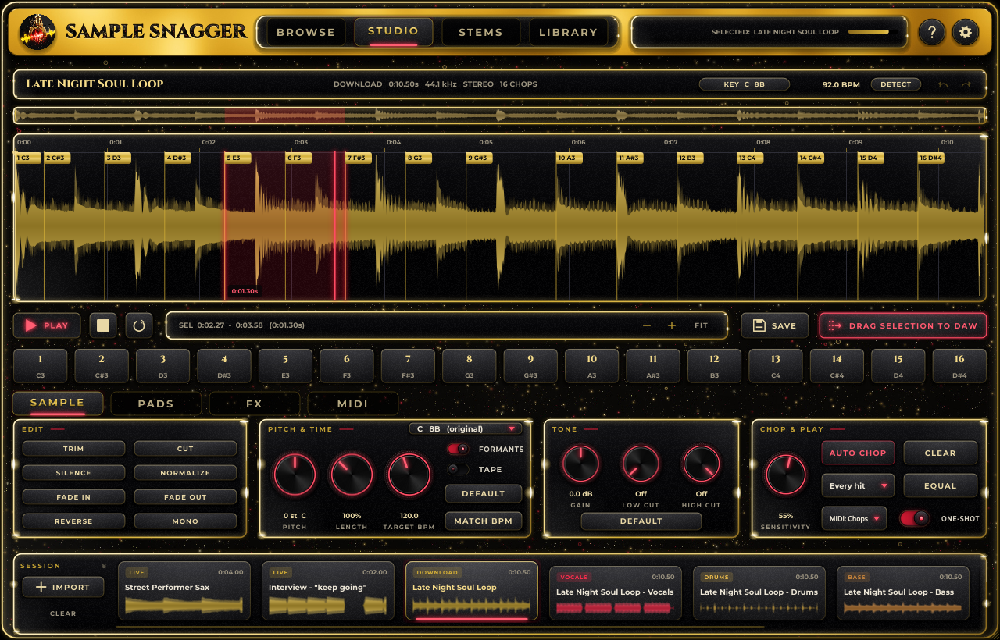
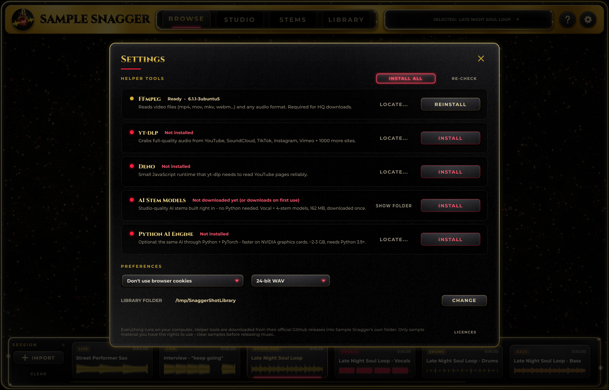
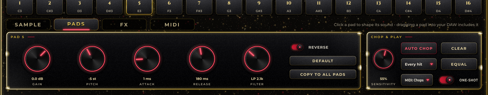
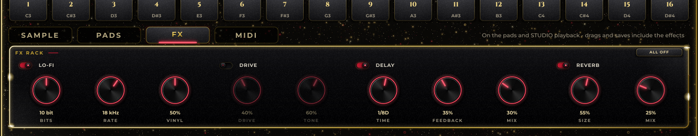
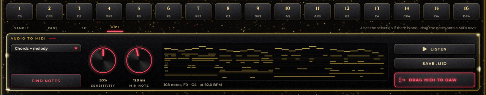
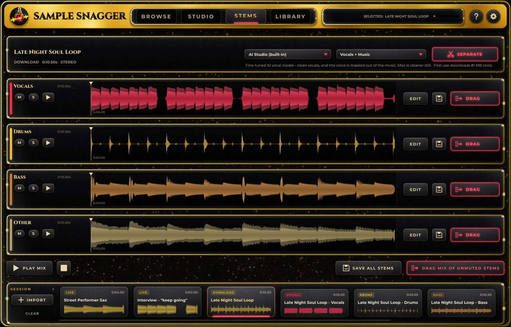
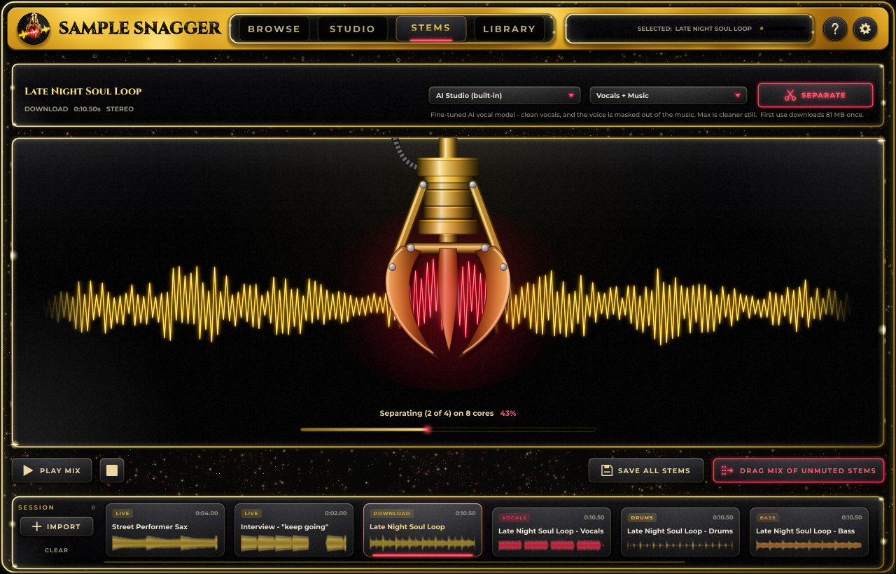
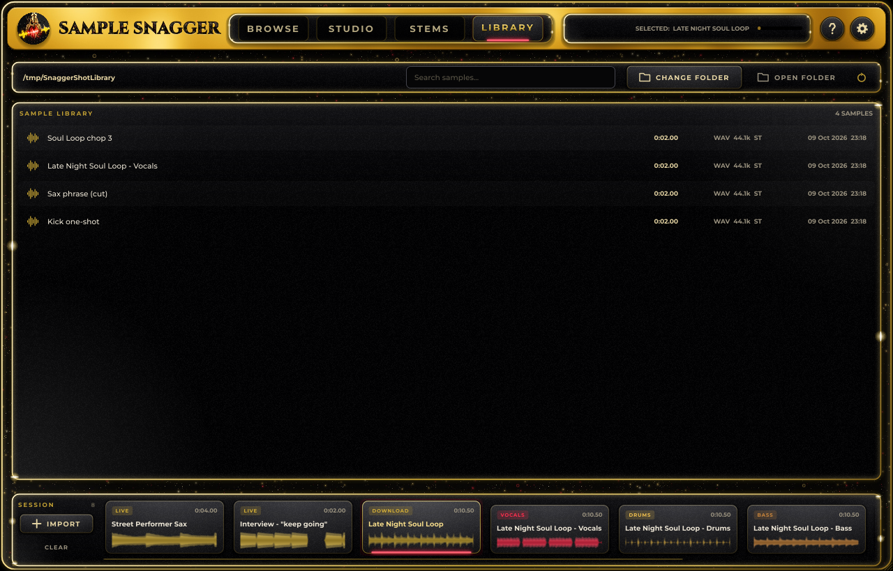

# Sample Snagger Manual

Capture, chop, separate. This is the full guide to the Sample Snagger plug-in and standalone app.
The same manual is built into Sample Snagger: click the **?** button in the title bar (or press F1).

## Welcome

Sample Snagger is a sampling plug-in and standalone app. You find a sound, grab it, shape it and drop it
onto a track in your DAW, all in one window.

- **Capture** audio from the built-in web browser, from a link, from a file, or from your audio input.
- **Chop** it in STUDIO: trim, pitch, stretch, slice it onto pads and play the pads from MIDI.
- **Separate** it in STEMS: pull vocals, drums, bass and more out of a finished mix with built-in AI.
- **Use** it: drag any sound, pad, stem or MIDI part straight into your DAW, or save it to your library.

It comes in these formats:

| Format | Where it works |
|---|---|
| VST3 | Ableton Live, FL Studio, Cubase, Studio One, Reaper, Bitwig, Cakewalk and more (Mac and Windows) |
| AU | Logic Pro, GarageBand, MainStage, Ableton Live on Mac |
| Standalone app | Mac, Windows and Linux, no DAW needed |
| LV2 | Linux hosts |
| AAX | Pro Tools (optional, only if you build it yourself) |

Everything runs on your own computer. Nothing you capture is uploaded anywhere.

## Quick start

From nothing to a chopped sample on a track, in about a minute:

1. Put Sample Snagger on an **instrument / MIDI track** in your DAW (it is an instrument plug-in), or open the standalone app.
2. In **BROWSE**, find a video and press play. When you hear something you like, click **20s** under *Hindsight* to grab the last 20 seconds.
3. The capture lands in the **Session tray** at the bottom. Double-click it to open it in **STUDIO**.
4. Pick **8 chops** in the *Chop & Play* panel and click **AUTO CHOP**. The chops appear on the pads.
5. Play the pads from your MIDI keyboard (chop 1 is on C3), or drag any pad onto an audio track in your DAW.

> The first time, open Settings (the gear, top right) and click INSTALL ALL. That adds the helper tools for HQ SNAG, video files and AI stems. See "Install and first run".

## Install and first run

### Installing

- **Mac:** open `Sample-Snagger-x.y.z-macOS.pkg`. It installs the AU, the VST3 and the app. The builds are not notarised by Apple yet, so the first time right-click the .pkg and choose **Open**.
- **Windows:** run `Sample-Snagger-x.y.z-Windows-Setup.exe`. It installs the VST3 into `C:\Program Files\Common Files\VST3` and the standalone app. SmartScreen may warn about an unknown publisher: click *More info*, then *Run anyway*.
- **Linux:** unpack the `.tar.gz` and run `./install.sh`.

Then rescan plug-ins in your DAW. Sample Snagger shows up as an **instrument**, so load it on an instrument or MIDI track.

> Mac: if a DAW refuses to load the plug-in, run this once in Terminal: `sudo xattr -dr com.apple.quarantine "/Library/Audio/Plug-Ins/Components/Sample Snagger.component" "/Library/Audio/Plug-Ins/VST3/Sample Snagger.vst3" "/Applications/Sample Snagger.app"`

### Helper tools

Some features use small helper programs. Open **Settings** (the gear) to install them with one click.

| Tool | What it is for |
|---|---|
| FFmpeg | Video files and unusual audio formats. Needed for HQ SNAG. About 30 MB. |
| yt-dlp | HQ SNAG from YouTube and 1,000+ other sites. About 35 MB. |
| Deno | Helps yt-dlp read YouTube reliably. About 40 MB. |
| AI Stem Models | The built-in AI stem separation. Also downloads by itself the first time you split. 80-160 MB. |
| Python AI Engine | Optional. AI stems on an NVIDIA graphics card. Needs Python 3.9 or newer. 2-3 GB. |

**INSTALL ALL** installs everything except the optional Python engine. The tools are downloaded from their
official GitHub releases into Sample Snagger's own folder. Nothing else on your system is touched.

LIVE REC, hindsight grabs, IMPORT of normal audio files, Quick Split and everything in STUDIO work with no helper tools at all.

## The window

- **Title bar.** The four big tabs switch pages: **BROWSE**, **STUDIO**, **STEMS** and **LIBRARY**.
- **Status display** (right of the tabs). Shows the selected sample, or what Sample Snagger is busy doing, with a progress bar and an **x** to cancel. The small bar on its right is the output level.
- **? button.** Opens this manual.
- **Gear button.** Opens Settings: helper tools and preferences.
- **Session tray** (bottom). Every capture, import and stem of this session. It is always visible.
- **Messages** pop up in the bottom right corner for a few seconds. Errors stay a little longer.

Drag the bottom right corner to resize the window. Sample Snagger remembers the size and the tab you were on.
Hover over almost any control for a moment to see a tip.

### The Session tray

Each card is one clip. The badge shows where it came from: LIVE, DOWNLOAD, IMPORT, VIDEO, or the stem name.

| Do this | To get this |
|---|---|
| Click a card | Select it. STUDIO and STEMS work on the selected clip. |
| Double-click a card | Open it in STUDIO. |
| Drag a card | Drop it onto an audio track in your DAW, or onto your desktop. |
| Right-click a card | Play, Open in Studio, Separate stems, Save to library, Rename, Duplicate, Remove. |
| IMPORT | Add audio or video files. |
| CLEAR | Remove every clip from this session. Your library is not touched. |

Tray clips are saved with your DAW project, so a project reopens with its samples. The standalone app brings your last session back when you start it again.

## Browse: capture audio

BROWSE is where sounds come from. The top part is a web browser, the bottom strip is the capture deck.

### The browser

- Type search words in the address bar to search YouTube, or paste any video or audio link, then press Return or **GO**.
- The arrows, reload and home buttons work like any browser. Home is YouTube.
- The quick links open YouTube, SoundCloud, TikTok, Instagram, Vimeo, Bandcamp, Internet Archive and Freesound. Right-click a quick link to open it in your own browser instead.
- **Opens in:** chooses where sites open: inside Sample Snagger (LIVE REC and hindsight work there), or in your own browser such as Chrome, Safari or Edge. If you use your own browser, copy the video's link there and click HQ SNAG here.

The built-in browser is available on Mac and Windows. On Linux, paste a link and use HQ SNAG, or use IMPORT and REC INPUT.

### Capture: LIVE REC

**LIVE REC** records whatever is playing on the page, like a tape deck. Click it, press play on the video, and click it again to stop and keep the recording. The button shows the recording time while it runs.

On Windows 11 it records the built-in browser's own sound output, so it works on every site.

### Hindsight: grab the last 10s / 20s / 30s / 60s

Sample Snagger quietly keeps the last minute of audio that played in the built-in browser. When you hear something great, click **10s**, **20s**, **30s** or **60s** to grab it after it happened. The status line in the capture deck shows how many seconds are waiting.

> If it says "Click the video once to enable capture", click the video. Browsers only let a page be heard after you interact with it.

### HQ SNAG

**HQ SNAG** downloads the page's audio in full quality with yt-dlp. It works with YouTube and 1,000+ other sites. On a site yt-dlp does not know, it grabs the audio file the page is actually playing instead.

To snag only a section:

1. Play the video to where the part starts and click **SET IN**.
2. Let it play to where the part ends and click **SET OUT**.
3. Click **HQ SNAG SECTION**. The **x** clears IN and OUT so the whole thing is downloaded again.

HQ SNAG needs FFmpeg and yt-dlp from Settings.

### More sources

- **IMPORT** opens any audio or video file: wav, aiff, flac, ogg, mp3, m4a, mp4, mov, mkv, webm, avi and more. You can also drop files anywhere on the window. Video files and some formats need FFmpeg.
- **REC INPUT** records your audio interface in the standalone app, or whatever your DAW routes into the plug-in. Click it again to stop.

## Studio: the waveform

STUDIO is where you edit the selected clip.

### The top row

- **Name.** Double-click it to rename the sample.
- **Info.** Where it came from, its length, sample rate, mono or stereo, and how many chops it has.
- **KEY.** The detected key and its Camelot code, for example *Am 8A*. It is found by itself when you open a sample. Click it to pick from the likeliest keys, set it yourself, or detect again.
- **BPM** and **DETECT.** DETECT finds the tempo and the key.
- **Undo / redo** arrows. There are 30 levels of undo for each sample.

### Looking around

The thin strip above the waveform is the overview: the whole sample, with the part you are looking at marked.

| Do this | To get this |
|---|---|
| Scroll up or down over the waveform | Zoom in and out around the mouse (Cmd/Ctrl + scroll does the same). |
| Scroll sideways, or Shift + Cmd/Ctrl + scroll | Move left and right. |
| Pinch on a trackpad | Zoom. |
| + and - buttons | Zoom in and out. |
| FIT | Show the whole sample. |
| Right-click the waveform | Zoom to selection, Zoom to fit, and the chop marker commands. |

### Selecting and playing

| Do this | To get this |
|---|---|
| Drag across the waveform | Select a region. |
| Drag an edge of the selection | Adjust it. |
| Shift-click | Extend the selection to that point. |
| Double-click inside a chop | Select that chop. |
| Click the time ruler at the top | Put the cursor there and play from it. |
| Click the waveform while it plays | Jump playback to that point. |
| PLAY, or Space | Play the selection, or play from the cursor. Space again stops. |
| Loop button | Loop the playback. |

The readout next to the transport shows the selection's start, end and length.

### SAVE and DRAG TO DAW

- **SAVE** writes the selection (or the whole sample if nothing is selected) as a WAV into your library.
- **DRAG SELECTION TO DAW / DRAG SAMPLE TO DAW**: drag this button onto an audio track in your DAW, or onto your desktop or a sample folder.

## Studio: Sample tools

The tool area under the pads has four tabs: **SAMPLE**, **PADS**, **FX** and **MIDI**. This chapter covers SAMPLE.

### Edit

| Button | What it does |
|---|---|
| TRIM | Keeps only the selection. |
| CUT | Deletes the selection. The Delete key does the same. |
| SILENCE | Silences the selection. |
| NORMALIZE | Makes it as loud as possible without clipping (peak at -0.3 dB). |
| FADE IN | Fades in over the selection, or over the first 5% if nothing is selected. |
| FADE OUT | Fades out over the selection, or over the last 5%. |
| REVERSE | Reverses the selection, or the whole sample. |
| MONO | Sums the sample to mono. |

TRIM, CUT and SILENCE need a selection. Drag across the waveform first.

### Pitch & Time

- **PITCH** shifts the pitch by up to 24 semitones up or down, without changing the length. When the key is known, the number under the knob also shows the key the sample lands on.
- **LENGTH** stretches the sample from 50% to 200% without changing the pitch.
- **TO KEY** shifts the sample into any key by setting PITCH for you.
- **FORMANTS** keeps voices natural when you pitch them (no chipmunk effect). It is on by default.
- **TAPE** is old-school varispeed: pitch and speed change together, like a record or a tape.
- **TARGET BPM** and **MATCH BPM**: MATCH BPM sets LENGTH so the sample plays at the target tempo. In a DAW the target follows your project's tempo. If the sample's own tempo is not known yet, it is detected first.
- **DEFAULT** puts pitch and length back to the original.

### Tone

- **GAIN** makes the sample louder or quieter, up to 24 dB either way.
- **LOW CUT** removes bass below the frequency you set. All the way down is off.
- **HIGH CUT** removes treble above the frequency you set. All the way up is off.
- **DEFAULT** puts the gain back and switches both filters off.

The PITCH & TIME and TONE knobs apply as you turn them, even while the sample plays, and they always work from the original sound, so turning a knob back loses nothing. Each sample remembers its own knob settings.

> Double-click the number under any knob to type an exact value, such as `-3.5`, `+7`, `8k` or `off`. Press Return to apply it, or Esc to cancel.

### Chop & Play

Chopping cuts the sample into pieces that go onto the pads.

- **The chop list** sets how many chops you want: 2, 3, 4, 6, 8, 12, 16, 24 or 32, or **Every hit**.
- **AUTO CHOP** with a number cuts exactly that many chops at the strongest hits. With *Every hit* it puts a chop on each hit, and **SENSITIVITY** decides how many it finds.
- **EQUAL** cuts the chosen number of chops evenly. This is great for loops.
- **CLEAR** removes all the chops.
- If there is a selection, AUTO CHOP and EQUAL only chop inside the selection and leave the other chops alone.

You can also place chop markers by hand:

| Do this | To get this |
|---|---|
| Alt-click the waveform (Option-click on Mac) | Add a chop marker there. |
| Drag a marker | Move it. |
| Double-click a marker | Delete it. |
| Right-click | Add a marker, delete this marker, or clear all markers. |

## Studio: pads and MIDI

### Playing the pads

The row of pads under the waveform holds your chops, up to 32 of them.

- Click a pad to hear it. The pad also selects its chop in the waveform.
- **Drag a pad** onto a track in your DAW to drop just that chop, with its pad sound and the effects.
- From a MIDI keyboard or your DAW's piano roll, chop 1 plays on **C3**, chop 2 on C#3, and so on up the keys. Each pad shows its note. C3 here is MIDI note 60, which some DAWs call C4.
- **ONE-SHOT** on: a chop plays to its end. Off: it stops when you let go of the key.
- **MIDI: Chops / MIDI: Keys.** In *Keys* mode the sample (or the selection) plays chromatically across the keyboard instead, with C3 as the original pitch.

### The PADS tab

Click a pad, then shape its sound. Every pad has its own settings.

| Control | What it does |
|---|---|
| GAIN | The pad's volume. |
| PITCH | Pitches this chop up or down in semitones. It plays faster or slower, like a classic sampler. |
| ATTACK | Fades the chop in. |
| RELEASE | Fades the chop out at its end, and after you let go of the key when ONE-SHOT is off. |
| FILTER | Left of the middle is a low-pass (darker), right is a high-pass (thinner), the middle is off. |
| REVERSE | Plays this chop backwards. |
| DEFAULT | Puts this pad back to how the chop sounds on its own. |
| COPY TO ALL PADS | Gives every pad this pad's settings. |

Dragging a pad into your DAW gives you exactly what the pad plays. Chopping again starts the pads with a clean sound; Undo brings the old ones back.

## Studio: FX

The FX tab is an effects rack for the pads and for STUDIO playback. Each effect has its own on/off switch.

| Effect | What it does |
|---|---|
| LO-FI | **BITS** crushes the bit depth, **RATE** lowers the sample rate, and **VINYL** adds a worn record: crackle, hiss, wow and flutter. |
| DRIVE | Warm tube-style saturation. **DRIVE** sets how much, **TONE** how bright. |
| DELAY | A ping-pong echo locked to your DAW's tempo (or the sample's). **TIME** goes from 1/32 to 1 bar, with dotted (D) and triplet (T) values. **FEEDBACK** sets how many repeats, **MIX** how loud. |
| REVERB | Room and hall reverb. **SIZE** sets the space, **MIX** how much. |

**ALL OFF** switches every effect off and leaves the knobs where they are.

Drags and saves include the effects, with the echoes and reverb tails included. Each sample keeps its own FX settings.

## Studio: audio to MIDI

The MIDI tab turns a sample into MIDI notes: melodies, bass lines and chords. It uses Spotify's Basic Pitch model, which is built in and works offline.

1. Open the sample in STUDIO. To convert only a part, select it in the waveform first.
2. Click **FIND NOTES**. The notes appear on the little piano roll.
3. Click **LISTEN** to hear the notes, **SAVE .MID** to save them to your library, or drag **DRAG MIDI TO DAW** onto a MIDI or instrument track.

These controls re-shape the result instantly, without analysing again:

- **SENSITIVITY**: higher finds quieter notes too, and more stray ones.
- **MIN NOTE**: notes shorter than this are left out.
- **Chords + melody / Melody only**: *Melody only* keeps one note at a time. It is best for a vocal, a bass line or a lead.

> For the cleanest notes, separate the part in STEMS first, then open that stem in STUDIO and find its notes. Samples longer than 15 minutes need a selection.

## Stems: separate vocals and music

STEMS splits the selected clip into its parts.

1. Select a clip in the tray and open **STEMS**.
2. Choose an **engine** in the first menu.
3. Choose the **parts** you want in the second menu. Tick any mix of *Vocals, Music (everything but vocals), Drums, Bass, Guitar, Piano* and *Other*, or pick a preset: *Vocals + Music*, *Vocals, Drums, Bass, Other*, or *Everything*.
4. Click **SEPARATE**. The gold claw works on the sound while the progress shows below. When it is done, the stems appear as lanes.

### Engines

| Engine | What it is |
|---|---|
| AI Studio (built-in) | The default. Studio-quality AI separation (Demucs v4) that runs inside Sample Snagger on all your CPU cores. No Python, no graphics card needed, works offline. |
| AI Studio Max | Four fine-tuned models, one per part. The cleanest result, about 4 times slower. |
| Quick Split | Instant and rough. It guesses from stereo placement, so it is handy for a quick preview of a stereo mix. It cannot find guitar or piano. |
| AI via Python (GPU) | Optional. The same models through Python and PyTorch. Only worth it if you have an NVIDIA graphics card. |

Sample Snagger picks the right AI model for the parts you ticked. Each model (about 50-80 MB) downloads once, the first time it is needed. After that it works offline. The note under the menus tells you what will be used and whether a download is needed.

### Working with the stems

| Control | What it does |
|---|---|
| M / S | Mute or solo the stem in the mix. |
| Play button on a lane | Plays that stem on its own. Click again to stop. |
| Click or drag in a stem's waveform | Moves the playhead. Playback starts there, or jumps there if it is already playing. |
| EDIT | Opens the stem in STUDIO to chop or edit it. |
| Save button on a lane | Saves that stem to your library. |
| DRAG | Drag the stem onto a track in your DAW. |
| PLAY MIX | Plays the stems you have not muted, from the playhead. |
| SAVE ALL STEMS | Saves every stem to your library. |
| DRAG MIX OF UNMUTED STEMS | Exports only the stems you left un-muted as one file, for example drums + bass. |

Stems also appear in the Session tray, so you can use them like any other clip.

## Library

The library holds the samples you saved. It is a normal folder on your disk, so you can use it in any DAW or file browser. By default it is `Documents/Sample Snagger/Samples`.

| Do this | To get this |
|---|---|
| Click a row | Audition the sample. |
| Double-click a row | Load it into the Session tray. |
| Drag a row | Drop it onto an audio track in your DAW. |
| Right-click a row | Load into tray, Show in folder, or Move to trash. |
| Type in the search box | Filter the list by name. |
| CHANGE FOLDER | Use a different folder as your library. |
| OPEN FOLDER | Show the library folder in Finder or Explorer. |
| Reload button | Rescan the folder. |

Things land in the library when you click SAVE in STUDIO, save a stem in STEMS, choose *Save to library* in the tray, or save a .MID file.

## Getting sounds into your DAW

Almost everything in Sample Snagger can be dragged straight onto a track. You can also drop it on your desktop or in a sample folder to get a file.

Sounds are audio files, so drop them on an **audio track**, or on the empty space below your tracks to get a new one. Only DRAG MIDI goes on a MIDI or instrument track.

> Sample Snagger's own track is an instrument track, so your DAW only lets it hold MIDI. Drag a sound over it and the DAW shows a no-entry sign, or makes a new audio track for it. That is the DAW's rule, not a fault. In the plug-in, the first few drags remind you where to drop.

| Drag this | You get |
|---|---|
| A card in the Session tray | The whole clip. |
| DRAG SELECTION / SAMPLE TO DAW in STUDIO | The selection, or the whole sample, with the effects. |
| A pad | That one chop, exactly as the pad plays it, with the effects. |
| DRAG MIDI TO DAW in the MIDI tab | The found notes as a MIDI clip. Drop it on a MIDI or instrument track. |
| DRAG on a stem lane | That stem. |
| DRAG MIX OF UNMUTED STEMS | One file with only the stems you left un-muted. |
| A row in LIBRARY | The saved file. |

Audio is exported as WAV. Choose 16-bit, 24-bit or 32-bit float in Settings.

To play chops live instead, record or draw MIDI notes on Sample Snagger's own track: chop 1 is C3.

## Plug-in and standalone app

Both are the same Sample Snagger, with a few differences:

| | Difference |
|---|---|
| Tempo | In a DAW, MATCH BPM and the DELAY follow the project tempo. |
| Saving | In a DAW, the Session tray is saved with the project. The standalone app restores your last session. |
| REC INPUT | The standalone app records your audio interface. The plug-in records what your DAW routes into it. |
| Audio / MIDI settings | Only in the standalone app: Settings > AUDIO / MIDI SETTINGS picks your sound card, input and MIDI keyboard. |

### Recording inside a DAW

Enable Sample Snagger's side-chain or audio input in your DAW, route a track into it, then click REC INPUT. Some DAWs, such as Ableton Live and FL Studio, do not feed audio into instrument plug-ins. Use the browser capture, IMPORT or the standalone app there.

### Recording other apps

To record system audio from other apps (Spotify, a game and so on), use the standalone app, choose a loopback input in the audio settings (BlackHole on Mac, "Stereo Mix" or VB-Cable on Windows) and click REC INPUT.

## Settings

Click the gear in the title bar. Click outside the card, the **x**, or press Esc to close it.

### Helper tools

Each row shows a tool, whether it is ready, and its version.

- **INSTALL** downloads it. Once installed the button becomes **REINSTALL**, or **UPDATE** for yt-dlp.
- **LOCATE...** uses a copy you already have on your computer.
- **SHOW FOLDER** (AI Stem Models) opens the folder where the models are kept.
- **INSTALL ALL** installs everything that is missing, except the optional Python engine.
- **RE-CHECK** looks for the tools again.

### Preferences

- **Use cookies from...** lets HQ SNAG reach age-restricted or sign-in-only videos using the login of your normal browser (Chrome, Firefox, Safari, Edge, Brave, Opera or Vivaldi).
- **16-bit / 24-bit / 32-bit float WAV** sets the format for saves and drags.
- **LIBRARY FOLDER** and **CHANGE** set where saved samples go.
- **AUDIO / MIDI SETTINGS** (standalone app only) picks your devices.
- **LICENCES** lists the open-source software inside Sample Snagger.

## Shortcuts

### Keyboard

| Key | What it does |
|---|---|
| Cmd/Ctrl + 1, 2, 3, 4 | Switch to BROWSE, STUDIO, STEMS, LIBRARY. |
| Space | Play / stop (in STUDIO), or stop whatever is playing. |
| Cmd/Ctrl + Z | Undo. |
| Shift + Cmd/Ctrl + Z | Redo. |
| Delete or Backspace | Cut the selection. |
| F1 | Open or close this manual. |
| Esc | Close Settings or the manual. Cancel typing a knob value. |
| Return | Apply a typed knob value. Go to the address typed in BROWSE. |

Some DAWs keep certain keys, such as Space, for themselves. Click inside Sample Snagger first, or use the buttons.

### Mouse

| Do this | To get this |
|---|---|
| Scroll over the waveform | Zoom. |
| Alt-click the waveform (Option-click on Mac) | Add a chop marker. |
| Shift-click the waveform | Extend the selection. |
| Double-click a chop | Select it. |
| Double-click a chop marker | Delete it. |
| Double-click the number under a knob | Type an exact value. |
| Double-click the sample name | Rename it. |
| Right-click | More options on the waveform, tray cards, library rows and quick links. |

## Troubleshooting

### Capturing

- **YouTube asks you to sign in, or the video is age-restricted.** In Settings, set *Use cookies from* to the browser you are logged into. Or just use LIVE REC or a hindsight grab.
- **HQ SNAG stopped working on YouTube.** Click **UPDATE** next to yt-dlp in Settings. Sites change often and yt-dlp keeps up.
- **HQ SNAG says a tool is missing.** Open Settings and click INSTALL ALL.
- **"Nothing was captured."** Make sure the video is playing and is not muted on the page, then try again.
- **"This site's player can't be recorded from the page."** Click HQ SNAG while it plays. It grabs the file itself.
- **"Click the video once to enable capture."** Click the video. The page needs one click before it can be heard.
- **REC INPUT recorded silence.** Check the input device. In the standalone app: Settings > AUDIO / MIDI SETTINGS.

### In your DAW

- **Sample Snagger is not in the plug-in list.** Rescan plug-ins, and look under instruments, not effects.
- **The pads make no sound from MIDI.** Put Sample Snagger on an instrument / MIDI track, chop the sample first, and play from C3 upward (MIDI note 60, which some DAWs call C4).
- **Mac: the DAW refuses to load it.** Run the Terminal command in "Install and first run" once.
- **A dragged sound will not drop on the Sample Snagger track.** That track only takes MIDI. Drop sounds onto an audio track, or onto the empty space below your tracks for a new one. Drop DRAG MIDI onto a MIDI or instrument track.
- **Dropping a sound made a new track.** Your DAW does that when you drop audio on the track list or on empty space. To put it on a track you already have, drop it in that audio track's lane.

### Stems

- **The first separation takes a while to start.** The AI model is downloading. It happens once per model.
- **The stems are not clean enough.** Use AI Studio instead of Quick Split, or AI Studio Max for the cleanest result.
- **Guitar or piano is missing.** Quick Split cannot find them. Pick AI Studio and tick Guitar or Piano.

### Everything else

- **A file will not import.** Install FFmpeg in Settings. It reads video files and unusual formats.
- **MATCH BPM says the change is too big.** LENGTH only goes from 50% to 200%. Try half or double the target tempo.
- **The key looks wrong.** Click KEY and pick another from the list, or choose *Detect again*.

## Where things are stored

| What | Where |
|---|---|
| Sample library (Mac) | `~/Documents/Sample Snagger/Samples` |
| Sample library (Windows) | `Documents\Sample Snagger\Samples` |
| Helper tools, AI models, session cache, settings (Mac) | `~/Library/Application Support/Sample Snagger` |
| Helper tools, AI models, session cache, settings (Windows) | `%APPDATA%\Sample Snagger` |
| Helper tools, AI models, session cache, settings (Linux) | `~/.config/Sample Snagger` |

Session clips are cached as WAV files so projects reopen with their samples. You can delete old folders in `Sessions` whenever you like.

## Sampling responsibly

Sample Snagger captures audio you can already hear or already have on disk. Clear any samples you use in released music, and follow the terms of the sites you capture from.

### Credits

Sample Snagger is built with JUCE, Signalsmith Stretch (pitch and time), demucs.cpp with Meta's Demucs v4 models (AI stems), Spotify's Basic Pitch (audio to MIDI), yt-dlp, FFmpeg and Deno. The full list and licences are in Settings > LICENCES.
